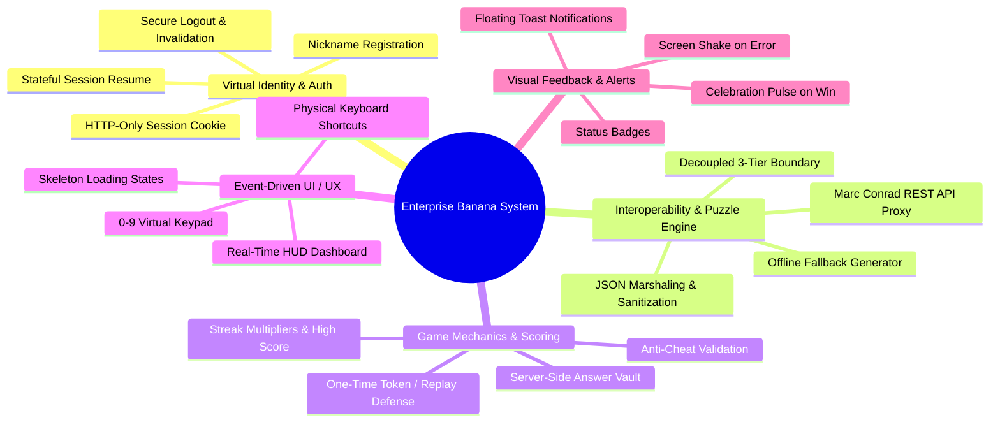
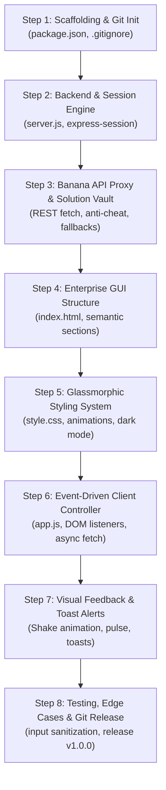

# Enterprise Banana Challenge — System Features & Step-by-Step Implementation Guide
## CIS046-3: Software For Enterprise | Assignment 1

---

## 1. System Overview: What We Are Building

We are building the **Enterprise Banana Challenge System**, a distributed, 3-tier mathematical puzzle application designed to industrial enterprise standards. The system challenges players with visual algebraic puzzles fetched dynamically from an external service (**Dr. Marc Conrad’s Banana API**), provides real-time gamified scoring, tracks virtual player identities across stateless HTTP, and ensures anti-cheat protection through server-side evaluation.

### Core Value Proposition
- **Enterprise Security**: The client browser never receives the solution to the puzzle; cheating via browser inspection is impossible.
- **Rich User Experience**: High-end glassmorphic dark interface, responsive 0–9 virtual keypad, physical keyboard accessibility, and rich visual feedback with micro-animations.
- **Robust Resilience**: Built-in 5-second API timeout protection and offline fallback puzzle generators ensure the system never crashes.
- **Full Academic Alignment**: Directly demonstrates the four computer science paradigms required by the University of Bedfordshire: **Version Control**, **Event-Driven Programming**, **Interoperability**, and **Virtual Identity**.

---

## 2. Comprehensive Feature Breakdown

Below is the complete list of all features implemented across the application, categorized by system subsystem.



---

### Feature Category 1: User Authentication & Virtual Identity

| Feature Name | Description | Technical Implementation |
| :--- | :--- | :--- |
| **1.1 Nickname Registration** | Players enter a custom username/nickname to initiate their virtual identity without requiring complex password setups. | Form input captured in `public/app.js`, dispatched to `POST /api/auth/login`. Sanitized and stored in server memory. |
| **1.2 HTTP-Only Session Persistence** | Authenticates player state over the stateless HTTP protocol without storing credentials in insecure `localStorage`. | `express-session` issues a cryptographically signed `connect.sid` cookie flagged with `httpOnly: true` and `sameSite: 'lax'`. |
| **1.3 Automatic Session Resume** | If a player refreshes the webpage or re-opens their tab, their active session, score, and identity are instantly restored. | Client triggers `GET /api/auth/me` on `DOMContentLoaded`. If valid session exists, game HUD opens automatically. |
| **1.4 Session Invalidation & Logout** | Players can securely log out, destroying their active server session and clearing the tracking cookie. | `POST /api/auth/logout` calls `req.session.destroy()` and clears the cookie header, resetting UI to the login stage. |
| **1.5 Virtual Player Telemetry** | Tracks user session statistics: current score, highest score achieved, consecutive streak count, and total rounds played. | Maintained inside `req.session.user` and synchronized with the frontend HUD after each puzzle round. |

---

### Feature Category 2: External Interoperability & Puzzle Engine

| Feature Name | Description | Technical Implementation |
| :--- | :--- | :--- |
| **2.1 Marc Conrad API Consumption** | Communicates with the remote third-party REST service (`https://marcconrad.com/uob/banana/api.php?out=json`) to fetch algebraic matrix puzzles. | Server-side `fetch()` call inside `server.js`, marshaling JSON responses containing the question image URL and integer solution. |
| **2.2 Decoupled 3-Tier Proxy Boundary** | The browser client NEVER talks directly to Dr. Marc Conrad's API. The Node.js application server acts as a reverse proxy. | Prevents CORS issues, protects client privacy, and prevents exposure of third-party API implementation details to end users. |
| **2.3 Anti-Cheat Solution Isolation** | Before sending puzzle data to the browser, the backend strips the solution and stores it strictly in the private session vault. | `req.session.currentSolution = data.solution`. Response to browser contains only `{ question: data.question }`. Cheating via DevTools is eliminated. |
| **2.4 Offline Fallback Puzzle Generator** | If the external API service is down, slow, or unreachable, the system automatically falls back to an internal procedural puzzle. | 5-second `AbortController` timeout on external fetch. If aborted or rejected, serves an embedded SVG puzzle so gameplay is uninterrupted. |

---

### Feature Category 3: Game Logic & Scoring Engine

| Feature Name | Description | Technical Implementation |
| :--- | :--- | :--- |
| **3.1 Server-Side Answer Validation** | Answer checks occur exclusively on the backend server. The client simply submits a guessed integer. | `POST /api/game/submit-answer` accepts `{ answer: Number }`. Server checks `parseInt(answer) === req.session.currentSolution`. |
| **3.2 Anti-Replay Defense** | Once an answer is submitted, the stored session solution is immediately wiped from memory. | Prevents replay attacks where a client repeatedly submits the same answer to artificially inflate their score. |
| **3.3 Dynamic Scoring & Streak System** | Players earn +10 base points per correct answer. Consecutive correct answers increase a streak multiplier. | Correct answer: `streak += 1`, `score += (10 * streak)`. Incorrect answer: `streak = 0`. Highest score is preserved. |
| **3.4 Skip / Refresh Puzzle** | Players can forfeit a difficult puzzle to request a fresh one without resetting their session or total score. | Calling `GET /api/game/new-puzzle` discards the current solution, resets the streak, and fetches a new image. |
| **3.5 Session Stats Reset** | Option to reset game metrics (score and streak back to 0) while keeping the same virtual player logged in. | `POST /api/game/reset` zeroes out `req.session.user.score` and `streak` while preserving the player's username. |

---

### Feature Category 4: Event-Driven User Interface & UX

| Feature Name | Description | Technical Implementation |
| :--- | :--- | :--- |
| **4.1 On-Screen Virtual Keypad (0–9)** | Touchscreen- and mouse-friendly numeric keypad for fast, intuitive interaction on mobile and desktop devices. | Event delegation on `.keypad-btn` triggers input updates in `public/app.js` without physical keyboard dependence. |
| **4.2 Physical Keyboard Event Listeners** | Full desktop keyboard support: numbers `0` through `9` select the answer, `Enter` submits, and `Escape` clears. | `window.addEventListener('keydown', handleKey)` intercepts keyboard events, updates input fields, and submits forms. |
| **4.3 Non-Blocking Asynchronous Loaders** | During network transit, the UI displays animated skeleton placeholders; the browser thread is never blocked. | Native `async/await` with CSS shimmering skeleton loader while images and API responses are in flight. |
| **4.4 Real-Time Glassmorphic HUD** | Real-time display bar showing active user name, live score counter, streak badge with fire animation, and highest record. | Reactive `renderHUD()` updates DOM nodes instantly upon receiving API JSON responses. |
| **4.5 Fully Responsive Multi-Device UI** | Seamless layout transitions across smartphone (<600px), tablet (600–1024px), and wide desktop screens (>1024px). | CSS Grid and Flexbox responsive design system utilizing CSS custom properties (variables) in `public/style.css`. |

---

### Feature Category 5: Visual Feedback & Micro-Interactions

| Feature Name | Description | Technical Implementation |
| :--- | :--- | :--- |
| **5.1 Incorrect Answer Screen Shake** | Visual tactile feedback on wrong answer to clearly signal an incorrect deduction. | Triggers CSS keyframe animation `@keyframes shake` on the puzzle card for 400 milliseconds. |
| **5.2 Correct Answer Celebration Flash** | Emerald glow and border pulse highlighting successful puzzle resolution. | Applies CSS class `.card-correct` with emerald glowing box-shadow and scaling pulse. |
| **5.3 Floating Toast Notifications** | Non-intrusive floating alert banners that inform the user of events (e.g., "Streak x3 Activated!", "Solution was 7"). | Dynamic toast stack in `public/index.html` managed by `showToast(msg, type)` with auto-dismiss timers. |
| **5.4 Live Streak & Score Counters** | Dynamic badge highlights and counter transitions celebrating player progress. | Real-time DOM element class toggling (`streak-active`, `score-bump`) in `public/app.js`. |

---

## 3. Step-by-Step Implementation Walkthrough

Here is the exact step-by-step roadmap of how each component and feature is constructed from scratch.



---

### Step 1: Project Scaffolding & Version Control Setup
1. **Initialize Git Repository**:
   - Establish `main` branch.
   - Configure Git user and repository metadata.
2. **Create `.gitignore`**:
   - Add `node_modules/`, `package-lock.json`, `.env`, and OS logs to prevent committing junk or sensitive files.
3. **Generate `package.json`**:
   - Define project metadata, start script (`node server.js`), and dev script (`node --watch server.js`).
   - Specify runtime dependencies: `express`, `express-session`, `cors`.
4. **Install Dependencies**:
   - Run `npm install` to download dependencies cleanly into local environment.
5. **Git Commit**: `chore: initialize repository scaffolding, gitignore, and package dependencies`.

---

### Step 2: Application Server & Virtual Identity Infrastructure
1. **Initialize Express in `server.js`**:
   - Set up standard middleware: `express.json()` for JSON payloads and `express.static('public')` for serving frontend assets.
2. **Configure `express-session`**:
   - Set session secret key.
   - Configure cookie flags: `httpOnly: true` (prevents XSS cookie theft), `sameSite: 'lax'`, `maxAge: 24 * 60 * 60 * 1000` (24 hours).
3. **Implement Virtual Identity Endpoints**:
   - `POST /api/auth/login`:
     - Validates username string (trims whitespace, checks length 1–25).
     - Initializes `req.session.user = { username, score: 0, streak: 0, highScore: 0, gamesPlayed: 0 }`.
     - Returns `{ success: true, user: req.session.user }`.
   - `GET /api/auth/me`:
     - Checks if `req.session.user` exists.
     - Returns `{ authenticated: true, user: req.session.user }` or `401 Unauthorized`.
   - `POST /api/auth/logout`:
     - Calls `req.session.destroy()` and clears cookie.
     - Returns `{ success: true, message: "Logged out" }`.
4. **Git Commit**: `feat: implement express-session virtual identity and authentication routes`.

---

### Step 3: Banana API Proxy & Secure Solution Vault
1. **External API Fetcher Function**:
   - Create `fetchBananaPuzzle()` helper in `server.js`.
   - Target URL: `https://marcconrad.com/uob/banana/api.php?out=json`.
   - Implement `AbortController` with a 5000ms timeout.
2. **Offline Fallback Puzzle**:
   - Define local array of curated SVG math puzzles with known solutions (0–9).
   - If external API times out or throws a network error, return a fallback puzzle seamlessly.
3. **Endpoint `GET /api/game/new-puzzle`**:
   - Ensure user is authenticated via session check middleware.
   - Call `fetchBananaPuzzle()`.
   - **Critical Security Step**:
     - Save solution in session: `req.session.currentSolution = Number(data.solution)`.
     - Send ONLY the question image to client:
       ```javascript
       res.json({
         success: true,
         question: data.question,
         score: req.session.user.score,
         streak: req.session.user.streak
       });
       ```
4. **Endpoint `POST /api/game/submit-answer`**:
   - Ensure active puzzle exists: check `req.session.currentSolution !== undefined`.
   - Sanitize submitted answer: `const guess = parseInt(req.body.answer, 10)`. Validate `0 <= guess <= 9`.
   - Compare `guess === req.session.currentSolution`.
   - If correct:
     - Increment `req.session.user.streak += 1`.
     - Add points: `points = 10 * req.session.user.streak`.
     - Update `req.session.user.score += points`.
     - Update `highScore` if new score exceeds it.
   - If incorrect:
     - Reset `req.session.user.streak = 0`.
   - Clear `req.session.currentSolution = null` (anti-replay).
   - Respond with result: `{ correct, solution, pointsAwarded, newScore, streak, message }`.
5. **Git Commit**: `feat: implement 3-tier Banana API proxy, offline fallback, and server-side solution vault`.

---

### Step 4: Presentation Layer GUI Structure (`public/index.html`)
1. **HTML Document Header & Meta**:
   - Title: `Enterprise Banana Challenge | CIS046-3`.
   - Responsive viewport meta tag and modern Google Fonts (`Outfit` & `Inter`).
2. **Top Navigation Header**:
   - Brand logo and module badge (`CIS046-3: Assignment 1`).
   - Session indicator pill (`Status: Connected`).
   - "Log Out" button (hidden on login screen, visible when active).
3. **Screen 1: Virtual Identity Portal (`#auth-section`)**:
   - Hero welcome card with banana challenge theme illustration.
   - Text input: `#username-input` with placeholder "Enter your player nickname...".
   - Submit button: `#login-btn` ("Start Challenge").
4. **Screen 2: Enterprise Game Arena (`#game-section`)**:
   - **HUD Header**: Player name badge, Score badge, Streak multiplier with fire emoji, High score pill.
   - **Puzzle Display Container**: High-contrast card with `#puzzle-image` and shimmer loading skeleton `#puzzle-loader`.
   - **Input & Control Panel**:
     - Large numerical display box `#answer-display`.
     - 0–9 virtual keypad grid (`.keypad-btn` with data attributes `data-key="0"` to `data-key="9"`).
     - Action buttons: "Submit Answer", "Clear", "Skip Puzzle", "Reset Stats".
5. **Toast Container (`#toast-container`)**:
   - Dedicated DOM node for floating status toasts.
6. **Footer**:
   - Academic credits: University of Bedfordshire, Dr. Marc Conrad API attribution, student name.
7. **Git Commit**: `feat: construct accessible semantic HTML5 game layout and enterprise HUD`.

---

### Step 5: Enterprise Design System & Responsive CSS (`public/style.css`)
1. **Design Tokens & Theme Variables**:
   - Dark background: `--bg-primary: #0a0e17`, `--bg-card: #131c2e`.
   - Accents: `--banana-gold: #fbbf24`, `--emerald-win: #10b981`, `--crimson-err: #ef4444`.
   - Glassmorphism: `backdrop-filter: blur(14px)`, border transparency `rgba(255, 255, 255, 0.08)`.
2. **HUD & Keypad Layout**:
   - CSS Grid for 0–9 numeric keypad buttons (`grid-template-columns: repeat(5, 1fr)`).
   - Button hover elevation, tactile active press state (`transform: translateY(2px)`).
3. **Micro-Animations**:
   - `@keyframes shake`: 3-axis rapid wiggle for incorrect answers.
   - `@keyframes celebrate`: Scale-up pulse with glowing emerald shadow for correct answers.
   - `@keyframes shimmer`: Gradient sweep across skeleton loader while image loads.
4. **Responsive Media Queries**:
   - Mobile optimizations for small screens (<480px): stacked HUD, larger touch targets.
5. **Git Commit**: `feat: implement glassmorphic dark theme, responsive grid keypad, and CSS micro-animations`.

---

### Step 6: Event-Driven Client Logic (`public/app.js`)
1. **Central State Store**:
   - Manages `{ currentUser: null, currentInput: '', isSubmitting: false, currentStreak: 0 }`.
2. **Asynchronous API Client Helper**:
   - `async function api(endpoint, options)`: Standardizes `fetch()` requests, manages JSON parsing, and handles HTTP errors cleanly.
3. **Session Check on Load**:
   - `window.addEventListener('DOMContentLoaded', ...)` calls `GET /api/auth/me`.
   - If session exists: populate HUD, display `#game-section`, call `fetchNewPuzzle()`.
   - If no session: display `#auth-section`.
4. **Event Listeners for DOM Interactions**:
   - Login form submission: Dispatches `POST /api/auth/login`.
   - Virtual keypad clicks: Appends clicked number into input.
   - Physical keyboard handler (`keydown`):
     - Keys `0` through `9`: Updates answer input.
     - Key `Enter`: Triggers `submitAnswer()`.
     - Key `Backspace` or `Escape`: Clears input.
   - Action buttons: "Submit", "Skip", "Reset Stats", "Logout".
5. **Game Flow Controller**:
   - `fetchNewPuzzle()`: Shows loading skeleton, fetches from `/api/game/new-puzzle`, renders image on complete.
   - `submitAnswer()`: Sends guess to `/api/game/submit-answer`, evaluates response, triggers visual animations and toasts, updates HUD metrics.
6. **Git Commit**: `feat: implement event-driven app.js controller, keyboard listeners, and async game loop`.

---

### Step 7: Visual Feedback & Alert Dispatcher
1. **Visual Animations**:
   - Apply CSS keyframe animations for immediate feedback:
     - Error: `@keyframes shake` on the puzzle container.
     - Success: `.card-correct` emerald pulse and border glow.
2. **Toast Feedback Dispatcher**:
   - `showToast(message, type, duration)` creates animated alert pills in `#toast-container` with auto-removal.
3. **Git Commit**: `feat: implement visual feedback animations and dynamic toast notifications`.

---

### Step 8: Edge Cases, Security Hardening & Release Tagging
1. **Input Sanitization**:
   - Prevent entering non-numeric characters, multiple digits, or blank submissions.
2. **Network Timeout & Retry UI**:
   - If API fails, display friendly toast: "Serving offline challenge while connecting to Banana API".
3. **End-to-End Verification**:
   - Test complete game loop: Login -> Puzzle -> Keypad Input -> Correct -> Streak -> Incorrect -> Reset -> Logout.
   - Inspect browser DevTools Network tab: Verify that solutions never appear in `/api/game/new-puzzle` responses.
4. **Release Tagging**:
   - Merge feature branches into `main`.
   - Tag release: `git tag -a v1.0.0 -m "Release v1.0.0: Enterprise Banana Challenge System"`.
5. **Git Commit**: `docs: complete release v1.0.0, verification audit, and system documentation`.

---

## 4. Requirement-to-Feature Verification Checklist

| Requirement from Academic Brief | Implemented Feature in this System | How to Test & Verify |
| :--- | :--- | :--- |
| **Theme 1: Version Control** | Semantic commit logs, feature branching, `.gitignore`. | Run `git log --graph --oneline` to review isolated branches and commit messages. |
| **Theme 2: Event-Driven Programming** | Virtual keypad clicks, keyboard `keydown` triggers, async non-blocking fetch loops. | Type on keyboard or click keypad; observe immediate reactive UI without page reload. |
| **Theme 3: Interoperability** | REST integration with Marc Conrad API, JSON marshaling, decoupled 3-tier boundary. | Check `server.js` external fetch; open DevTools to confirm zero external calls from client. |
| **Theme 4: Virtual Identity** | Cookie session management (`connect.sid`), username binding, score persistence. | Refresh the page; observe player name and score automatically resume without re-login. |
| **Anti-Cheat Protection** | Server-side solution vault; client only gets image URL. | Inspect `/api/game/new-puzzle` response in DevTools; solution is nowhere in the payload. |
| **Fault Tolerance** | Offline fallback puzzle if third-party API is slow or offline. | Simulate network cutoff or test timeout; observe game continues playing without crashing. |

---

## 5. Summary

With **`plan.md`** defining the academic grading criteria, timeline, and video presentation breakdown, and **`features.md`** detailing every system capability and implementation step, you now have a complete, industrial-grade blueprint ready for code development.
