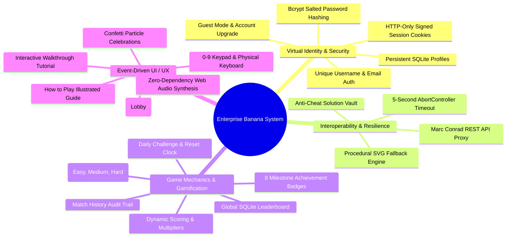

# Enterprise Banana Challenge — System Features & Architectural Guide
## CIS046-3: Software For Enterprise | Assignment 1 (AY 2026/2027)

---

## 1. System Overview

The **Enterprise Banana Challenge System** is a distributed, 3-tier mathematical puzzle application engineered to professional industrial standards. The system engages players with algebraic visual puzzles dynamically generated by **Dr. Marc Conrad’s Banana API** service (University of Bedfordshire), provides real-time gamified scoring, tracks persistent virtual identities across stateless HTTP, and guarantees anti-cheat protection through server-side evaluation.

### Core Value Proposition
- **Enterprise Security & Anti-Cheat**: Puzzle solutions are strictly vaulted on the server; the client browser receives only the question image, preventing inspection exploits.
- **Warm Cream Casual Arcade UI**: Polished, professional casual mobile gaming aesthetic with zero distracting neon glows, dark dashboards, or floating particles.
- **Lobby & Hub Flow**: Intuitive navigation flow (`Login/Register → Game Home (Lobby) → Game Arena → Results`).
- **Educational Accessibility**: Illustrated 4-step "How to Play" guide and an interactive walkthrough tutorial with real deduction keypad practice.
- **Robust Resilience**: Built-in 5-second `AbortController` timeout protection and offline procedural SVG fallback generators ensure 100% uptime.
- **Full Academic Alignment**: Directly demonstrates the four computer science paradigms required by the University of Bedfordshire: **Version Control**, **Event-Driven Programming**, **Interoperability**, and **Virtual Identity**.

---

## 2. Comprehensive Feature Breakdown

---

### Feature Category 1: User Authentication & Virtual Identity

| Feature Name | Description | Technical Implementation |
| :--- | :--- | :--- |
| **1.1 Account Registration** | Players create virtual identities with unique usernames, validated emails, and secure passwords. | `POST /api/auth/register` validates input, verifies email format, and hashes passwords with `bcryptjs` (10 salt rounds). |
| **1.2 Salted Password Security** | Defense against credential exposure and rainbow table attacks. | Passwords hashed using bcrypt. Only cryptographic hashes are written to the SQLite `users` table. |
| **1.3 HTTP-Only Session Persistence** | Maintains player authentication over stateless HTTP without vulnerable `localStorage` tokens. | `express-session` issues cryptographically signed `connect.sid` cookies with `httpOnly: true` and `sameSite: 'lax'`. |
| **1.4 Instant Guest Access & Upgrade** | Players can test the game instantly as a guest and later upgrade to a registered account without losing score or streak. | `POST /api/auth/guest` generates a unique guest identity. `POST /api/auth/upgrade` links credentials into SQLite. |
| **1.5 Persistent SQLite Profiles** | Player identities, avatars, honorific titles, scores, streaks, and round counts persist across server restarts. | SQLite embedded relational engine (`data/banana_game.sqlite`) with structured schemas, indexes, and WAL mode. |
| **1.6 Secure Session Invalidation** | Secure logout that destroys active server session data and clears tracking cookies. | `POST /api/auth/logout` executes `req.session.destroy()` and clears cookie headers. |

---

### Feature Category 2: External Interoperability & Puzzle Engine

| Feature Name | Description | Technical Implementation |
| :--- | :--- | :--- |
| **2.1 Marc Conrad REST API Proxy** | Communicates with the remote third-party service (`https://marcconrad.com/uob/banana/api.php?out=json`) to fetch algebraic matrix puzzles. | Server-side `fetch()` inside `services/bananaApi.js`, marshaling JSON responses containing question image URLs and solutions. |
| **2.2 Decoupled 3-Tier Proxy Boundary** | The browser client never communicates directly with Dr. Marc Conrad’s API. The Node.js server acts as an enterprise gateway. | Eliminates CORS issues, protects client privacy, and prevents third-party implementation leakage. |
| **2.3 Server-Side Solution Vaulting** | Before sending puzzle data to the client, the backend strips the solution and stores it strictly in the private session vault. | `req.session.currentSolution = data.solution`. Response to client contains only `{ question: data.question }`. Cheating via DevTools is impossible. |
| **2.4 Procedural Fallback Engine** | If the external API times out or is unreachable, an offline procedural SVG puzzle is served seamlessly. | 5-second `AbortController` timeout on external fetch. In case of timeout or network drop, procedurally generated SVG equations maintain gameplay. |

---

### Feature Category 3: Game Mechanics, Scoring & Difficulty Modes

| Feature Name | Description | Technical Implementation |
| :--- | :--- | :--- |
| **3.1 Difficulty Modes** | Three customizable difficulty modes: **Easy** (untimed, 1x), **Medium** (25s timer, 1.5x), and **Hard** (12s timer, 2x, -5 penalty). | `POST /api/game/mode` updates session configuration. Timer state and multiplier calculations are enforced server-side. |
| **3.2 Server-Side Answer Validation** | Answer validation occurs exclusively on the backend server. The client submits only a single guessed integer. | `POST /api/game/submit-answer` verifies `parseInt(answer) === req.session.currentSolution`. |
| **3.3 Anti-Replay Defense** | Once an answer is evaluated, the vaulted solution is immediately destroyed from memory. | Prevents replay attacks where users attempt to resubmit the same answer repeatedly to inflate scores. |
| **3.4 Milestone Achievement System** | 8 unlockable milestone achievements (e.g., First Banana, Sharp Mind, Speed Demon, Banana King). | Evaluated after each round in `database.js`. Recorded in `user_achievements` and surfaced in the client modal. |
| **3.5 Global SQLite Leaderboard** | Real-time global rankings displaying top player scores, best streaks, rounds played, and active dates. | `GET /api/game/leaderboard` executes ranked queries against the SQLite database. |
| **3.6 Round History Audit Trail** | Detailed history log tracking each round attempt, user guess, correct answer, points awarded, and timestamp. | Maintained in the `round_history` table and accessible via `GET /api/game/history`. |

---

### Feature Category 4: Game Home Screen (Lobby & Hub)

| Feature Name | Description | Technical Implementation |
| :--- | :--- | :--- |
| **4.1 Centralized Lobby Navigation** | Welcomes players post-authentication before diving into game rounds. | Semantic `#home-section` with banana mascot illustration, "Ready for a Brain Challenge?" heading, and "Play Now" action. |
| **4.2 Interactive Player Stat Cards** | Compact stat cards showcasing Best Score, Current Rank/Title, and Total Games Played. | Cards trigger modal navigation: clicking Best Score opens the Leaderboard; clicking Rank opens Customization; clicking Games opens Match History. |
| **4.3 Daily Challenge Strip** | Highlights a daily target challenge with an active reset clock countdown. | Tracks daily completion status in player session state. |
| **4.4 Player Customization Dialog** | Allows players to customize their profile avatar emoji (`🍌`, `🐵`, `👑`, `🚀`, `⭐`) and equipped title (`Banana Rookie`, `Monkey Sensei`). | Handled via `PUT /api/user/profile`, synchronizing avatar and title across the HUD and leaderboard. |

---

### Feature Category 5: Educational "How to Play" & Interactive Tutorial

| Feature Name | Description | Technical Implementation |
| :--- | :--- | :--- |
| **5.1 Illustrated 4-Step Guide** | Explains the game mechanics in four clear steps: Study the Puzzle, Find the Answer, Enter Your Answer, and Earn Points. | High-contrast illustrated SVG step cards embedded in the Home Screen before the footer. |
| **5.2 Difficulty Mode Explanations** | Visual explanation strip comparing Easy, Medium, and Hard pacing and score multipliers. | Responsive grid cards with color-coded badges and multiplier tags. |
| **5.3 4-Step Interactive Practice Tutorial** | Step-by-step modal walkthrough with active progress stepper dots (1 to 4). | Controlled by `TutorialController` in `public/app.js` with direct stepper dot navigation. |
| **5.4 Interactive Keypad Deduction Practice** | Hands-on sample puzzle (`5 + 🍌 = 9`) requiring the user to deduce and tap digit `4` on the keypad. | Validates practice input, provides real-time feedback, and triggers confetti celebration on completion. |
| **5.5 Dynamic Morphing Tutorial Button** | A single clean action button that transitions: *"Next: Spot the Banana"* → *"Next: Practice Keypad"* → *"Continue to Victory"* → *"Play Real Puzzle! 🚀"*. | Eliminates layout shifting and guarantees smooth step progression with built-in click debouncing. |

---

### Feature Category 6: Event-Driven UI, Audio Synthesis & Accessibility

| Feature Name | Description | Technical Implementation |
| :--- | :--- | :--- |
| **6.1 Virtual Numerical Keypad (0–9)** | Mouse- and touch-friendly keypad with large interactive buttons and 3D tactile depression states. | Event delegation on `.keypad-btn` in `public/app.js`. |
| **6.2 Physical Keyboard Navigation** | Full desktop keyboard integration: `0–9` select digits, `Enter` submits, `Escape`/`Backspace` clears. | `window.addEventListener('keydown', handleKey)` intercepts keyboard events without interfering with form inputs. |
| **6.3 Web Audio Sound Synthesizer** | Zero-dependency procedural sound effects generated directly via the browser's Web Audio API. | `SoundFX` object generates musical tones: UI clicks, C5–G5 harmonic win chords, wrong answer buzzers, and achievement jingles. |
| **6.4 Confetti Particle Celebrations** | Lightweight HTML5 Canvas particle explosion celebrating high scores and tutorial completions. | Custom canvas particle system triggered by `launchCelebrationConfetti()`. |
| **6.5 Responsive Breakpoints** | Seamless layout adaptation for mobile phones (<640px), tablets (640–960px), and desktops (>960px). | CSS Grid and Flexbox responsive structure in `public/style.css` (e.g. mobile stacks puzzle and keypad vertically). |

---

### Feature Category 7: Automated Integration Testing & Verification

| Feature Name | Description | Technical Implementation |
| :--- | :--- | :--- |
| **7.1 Comprehensive 14-Step Test Suite** | Automated end-to-end integration tests verifying every backend endpoint and security rule. | Executable via `npm test` (`test_suite.js`). Tests authentication, anti-cheat vaulting, database integrity, and sessions. |
| **7.2 Anti-Replay Defense Verification** | Automated test confirming that duplicate answer submissions are rejected with `400 Bad Request`. | Test Step 8 in `test_suite.js`. |
| **7.3 Conflict & Validation Testing** | Confirms duplicate username registrations are rejected with `409 Conflict`. | Test Step 4 in `test_suite.js`. |
