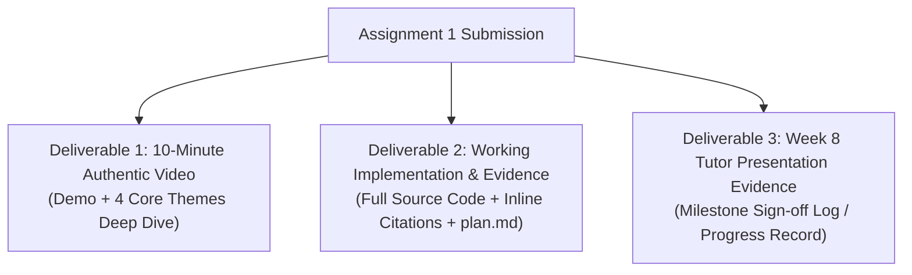
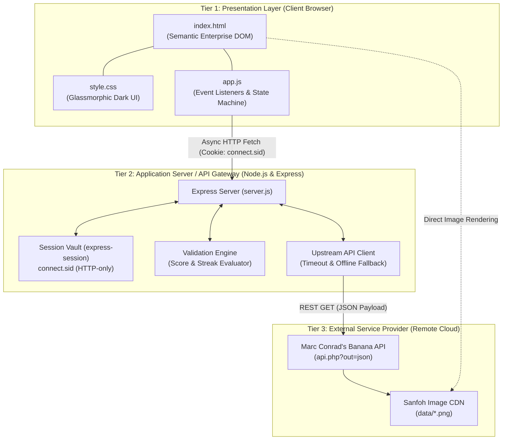
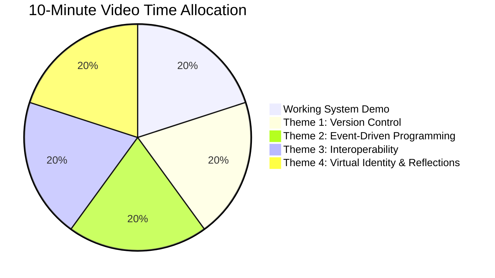

# CIS046-3 Software For Enterprise — Comprehensive Implementation & Assessment Plan
## Assignment 1: Enterprise Banana Challenge System (60% Weighting)

---

## 1. Executive Summary & Assessment Metadata

| Field | Detail |
| :--- | :--- |
| **Unit Title & Code** | CIS046-3: Software For Enterprise |
| **Institution** | University of Bedfordshire |
| **Assignment Number & Title** | Assignment 1: Banana Challenge Enterprise System |
| **Assessment Type** | Artifact Submission (10-Minute Video based on code + Supporting Evidence) |
| **Module Weighting** | 60% of total unit grade |
| **Video Duration** | Maximum 10 minutes (Must feature student's authentic voice) |
| **Submission Deadline** | 04/12/2026 before 10:00 a.m. |
| **Target Learning Outcome 1** | Differentiate and critically question the context and underpinning principles of collectively developing software to industry standard. |
| **Target Learning Outcome 2** | Develop, implement and critically appraise software solutions that are tailored against specific professional requirements. |
| **Graduate Competencies** | Digital Literacy, Collaboration & Communication, Problem Solving & Critical Thinking, Creativity & Entrepreneurship. |

---

## 2. Official Deliverables & Grade Cap Risk Management

The assignment brief establishes strict rules and grading caps. The table below details how this project guarantees compliance to avoid grade penalties.

### 2.1 The 3 Mandatory Deliverables



1. **Deliverable 1 — 10-Minute Authentic Video**:
   - Short initial demonstration of the running system.
   - Substantive discussion and comparative reflection of the **4 Core Themes** based directly on the developed codebase.
   - Must use the student's own authentic voice without substantive editing/voiceover alteration.
2. **Deliverable 2 — Working Source Code & Additional Material**:
   - Complete, functional 3-Tier source code (`server.js`, `public/index.html`, `public/style.css`, `public/app.js`, `package.json`).
   - Dedicated repository submission (GitHub repository + ZIP archive).
   - Strict inline academic attribution for third-party libraries, templates, and generative AI/LLM assistance.
   - Comprehensive design documentation (`plan.md`, `readme.md`) and testing logs.
3. **Deliverable 3 — Week 8 Tutor Presentation Evidence**:
   - Documentation verifying live presentation of the working code to the tutor in or before Week 8 practical sessions.

### 2.2 Grade Cap Prevention Matrix

The brief outlines specific failure conditions that cap final grades at **58%** (1 failure) or **48%** (2+ failures):

| Failure Condition | Consequence | Built-in Mitigation in this Project Plan |
| :--- | :--- | :--- |
| **1. Did not present code in/before Week 8** | Grade capped at 58 / 48 | **Milestone 3 & 4 (Week 7-8 Checkpoint)**: Implementation is ready by Week 7. Section 9 provides a formal Tutor Sign-Off Sheet template. |
| **2. Code does not address case study requirements** | Grade capped at 58 / 48 | **Strict 3-Tier Architecture**: Full integration with Dr. Marc Conrad's Banana API, session state, and GUI event listeners matching the brief exactly. |
| **3. No dedicated submission of code** | Grade capped at 58 / 48 | Code submitted as a standalone Git repository and clean packaged ZIP, not merely displayed on screen. |
| **4. Video does not have student's own voice** | Grade capped at 58 / 48 | Section 8 provides an authentic 10-minute presentation transcript and recording guide for the student's live speaking. |

---

## 3. Curriculum Progression & Alignment with Weekly Topics

The syllabus aligns with the practical development timeline as outlined in the assignment brief:

| Week | Lecture & Practical Software Topic | Assignment Implementation Phase | Relevant File / Artifact |
| :---: | :--- | :--- | :--- |
| **W1** | Commenting & code design; history of languages & enterprise scope | Code architecture planning & inline documentation rules | `plan.md`, `readme.md` |
| **W2** | **Version Control**: Git branching, commit conventions, repositories | Repository setup, `.gitignore`, initial commit, feature branch strategy | `.gitignore`, `package.json`, Git history |
| **W3** | **Interoperability**: RESTful APIs, JSON, 3-tier boundary | External Banana API integration (`https://marcconrad.com/uob/banana/`) | `server.js` (Proxy & Solution Vault) |
| **W4** | **GUI and Events**: Event loop, asynchronous DOM event listeners | Frontend enterprise dashboard, keypad, reactive listeners | `public/index.html`, `public/app.js`, `style.css` |
| **W5** | **Authentication & Cookies**: Virtual identity, state over stateless HTTP | `express-session`, HTTP-only cookies (`connect.sid`), user profiles | `server.js` (Session Controller), `app.js` |
| **W6-7** | Error resilience, input sanitization & edge cases | Fallback puzzle generation, timeout retry, visual feedback polish | `server.js`, `public/app.js` |
| **W8** | **Tutor Feedback Session & Checkpoint** | **Mandatory in-class code demonstration to tutor** | Deliverable 3 Sign-Off Log |
| **W9** | Refinement & code freeze | Incorporate tutor feedback, refactor edge cases | Git commits |
| **W10** | Video production & documentation | Record 10-minute authentic video, prepare transcript | Video MP4, slides/notes |
| **W11** | Final Submission | Hand-in before 10 a.m. deadline on BREO | BREO Submission Portal |

---

## 4. Requirements Traceability Matrix (RTM)

This matrix establishes 1-to-1 traceability from each assignment criterion to the specific architecture tier, file, function, and verification method.

| Requirement ID | Assignment Theme | Specification Detail | Tier | Target File & Function | Architectural Mechanism | Verification Method |
| :--- | :--- | :--- | :--- | :--- | :--- | :--- |
| **REQ-VC-01** | **Version Control** | Feature branch isolation & traceability | Dev / Repo | `.git/`, Git branches | Development on `feature/auth-sessions`, `feature/banana-api`, etc.; clean merge to `main`. | `git log --graph --oneline` shows isolated branch development. |
| **REQ-VC-02** | **Version Control** | Semantic conventional commit history | Dev / Repo | Git Commit Log | Commits prefixed with `feat:`, `fix:`, `docs:`, `chore:`, `refactor:`. | Commit log audit validates atomic increments. |
| **REQ-VC-03** | **Version Control** | Quarantined dependencies & security secrets | Dev / Repo | `.gitignore` | Excludes `node_modules/`, `.env`, temporary logs, OS metadata. | Zero transient or sensitive files tracked in Git. |
| **REQ-ED-01** | **Event-Driven** | Dynamic GUI user interaction handling | Tier 1 (Client) | `public/app.js` -> `setupEventListeners()` | Asynchronous event listeners (`click`, `keydown`, `submit`) preventing default page reload. | Browser responds instantly to keypad/keyboard inputs. |
| **REQ-ED-02** | **Event-Driven** | Non-blocking asynchronous I/O | Tier 1 (Client) | `public/app.js` -> `fetchPuzzle()`, `submitAnswer()` | Modern `fetch()` with Promises and `async/await`; visual loaders during network flight. | UI remains interactive without thread locking during API calls. |
| **REQ-ED-03** | **Event-Driven** | Server event-loop & middleware chaining | Tier 2 (Server) | `server.js` -> Express pipeline | Node.js asynchronous event loop; non-blocking HTTP middleware and asynchronous route controllers. | Multiple concurrent browser requests handled seamlessly. |
| **REQ-IN-01** | **Interoperability** | Third-party REST API integration | Tier 2 & Tier 3 | `server.js` -> `fetchBananaPuzzle()` | Node.js fetches JSON from Dr. Marc Conrad's service (`https://marcconrad.com/uob/banana/api.php?out=json`). | Backend receives valid JSON and parses `question` and `solution`. |
| **REQ-IN-02** | **Interoperability** | Decoupled 3-Tier Security Gateway | Tier 2 (Gateway) | `server.js` -> `/api/game/new-puzzle` | Reverse proxy: Server strips `solution` before sending image URL to browser. | Inspecting client network traffic reveals zero leaks of puzzle solutions. |
| **REQ-IN-03** | **Interoperability** | Fault tolerance & graceful fallback | Tier 2 (Gateway) | `server.js` -> Fallback Generator | 5-second network timeout with automatic fallback to local procedural puzzle if API is down. | Game remains 100% playable even if Marc Conrad's server is unreachable. |
| **REQ-VI-01** | **Virtual Identity** | Stateful session over stateless HTTP | Tier 2 (Server) | `server.js` -> `express-session` | Cryptographic session cookie (`connect.sid`, `httpOnly: true`) linking browser to backend memory. | Browser maintains game score and identity across refreshes. |
| **REQ-VI-02** | **Virtual Identity** | Player profile lifecycle & persistence | Tier 1 & Tier 2 | `server.js` (`/api/auth/*`), `app.js` | User login with virtual nickname, score tracking, streak count, high score, and clean logout. | User logs in, plays across multiple rounds, sees stats update, and logs out cleanly. |
| **REQ-VI-03** | **Virtual Identity** | Server-side solution validation vault | Tier 2 (Server) | `server.js` -> `/api/game/submit-answer` | Solution stored strictly in `req.session.currentSolution`. Validation occurs on server, not client. | Client-side cheating via browser DevTools inspection is impossible. |
| **REQ-AC-01** | **Academic Integrity** | Inline attribution & AI disclosure | All Tiers | All Source Files | Standardized header banners and inline comments citing Dr. Marc Conrad, open-source libraries, and AI usage. | Code passes academic integrity audit with zero undocumented code. |

---

## 5. System Architecture & 3-Tier Distributed Boundary

The solution strictly meets the **Threshold Expectation** of implementing a distributed enterprise architecture:



### 5.1 End-to-End Anti-Cheat Sequence Flow

```mermaid
sequenceDiagram
    autonumber
    actor Player as Student / User
    participant Client as Client Browser (Tier 1)
    participant Server as Node.js Gateway (Tier 2)
    participant Session as Session Store (Tier 2)
    participant BananaAPI as Marc Conrad API (Tier 3)

    %% Authentication
    Player->>Client: Enters virtual username "Alex" & clicks "Start Game"
    Client->>Server: POST /api/auth/login { username: "Alex" }
    Server->>Session: Create session { username: "Alex", score: 0, streak: 0 }
    Server-->>Client: Set-Cookie: connect.sid (HTTP-only); { success: true }
    Client->>Player: Transition from Login to Game HUD

    %% Puzzle Request (Decoupled Proxy)
    Client->>Server: GET /api/game/new-puzzle (Cookie: connect.sid)
    Server->>BananaAPI: GET https://marcconrad.com/uob/banana/api.php?out=json
    BananaAPI-->>Server: JSON { question: "https://...png", solution: 8 }
    
    Note over Server,Session: Interoperability Decoupling:<br>Solution '8' is isolated in session.<br>Never sent to Tier 1!
    Server->>Session: req.session.currentSolution = 8
    Server-->>Client: JSON { question: "https://...png", score: 0, streak: 0 }
    Client->>Player: Renders puzzle image & enables on-screen keypad

    %% Answer Submission
    Player->>Client: Clicks "8" or types 8 on keyboard
    Client->>Server: POST /api/game/submit-answer { answer: 8 } (Cookie: connect.sid)
    Server->>Session: Compare input (8) with req.session.currentSolution (8)
    Server->>Session: Increment score (+10) & streak (+1)
    Server-->>Client: JSON { correct: true, solution: 8, newScore: 10, streak: 1 }
    Client->>Player: Triggers success animation & toast, updates HUD
```

---

## 6. Detailed File Specifications & Code Blueprint

### 6.1 `package.json`
```json
{
  "name": "banana-game-enterprise",
  "version": "1.0.0",
  "description": "CIS046-3 Assignment 1: Enterprise Banana Challenge System",
  "main": "server.js",
  "scripts": {
    "start": "node server.js",
    "dev": "node --watch server.js"
  },
  "dependencies": {
    "express": "^4.19.2",
    "express-session": "^1.18.0",
    "cors": "^2.8.5"
  },
  "author": "Utsab",
  "license": "MIT"
}
```

### 6.2 `.gitignore`
```gitignore
node_modules/
package-lock.json
.env
*.log
npm-debug.log*
.DS_Store
Thumbs.db
.vscode/
.idea/
```

### 6.3 `server.js` (Tier 2 Application Gateway)
- **Session Management**: Configures `express-session` with secret key, 24-hour expiration, and HTTP-only cookie parameters.
- **Virtual Identity Endpoints**:
  - `POST /api/auth/login`: Validates non-empty username, initializes player session record (`score: 0`, `streak: 0`, `highScore: 0`, `history: []`).
  - `GET /api/auth/me`: Verifies active session on page load/refresh; returns 401 if unauthenticated.
  - `POST /api/auth/logout`: Clears session data, destroys cookie, returns success response.
- **Interoperability & Anti-Cheat Engine**:
  - `GET /api/game/new-puzzle`: Queries `https://marcconrad.com/uob/banana/api.php?out=json` with a 5-second timeout wrapper.
  - Saves the true numeric solution in `req.session.currentSolution`.
  - Responds to client with `{ success: true, question: data.question, score, streak }`.
  - Implements fallback SVG puzzle if the external network request fails.
- **Validation Engine**:
  - `POST /api/game/submit-answer`: Parses and sanitizes `answer` (`0` to `9`).
  - Compares against `req.session.currentSolution`.
  - Updates score (+10 for correct), streak count (+1 or reset to 0), and high score.
  - Returns result `{ correct: boolean, solution: number, newScore, streak, message }`.
  - Resets `req.session.currentSolution` to prevent replay attacks.
- **Attribution Banner**: Prominently cites Dr. Marc Conrad's API documentation and open-source packages at the top of the file.

### 6.4 `public/index.html` (Tier 1 Presentation GUI)
- Modern HTML5 semantic layout:
  - `<header>`: Enterprise brand banner, course code (`CIS046-3: Assignment 1`), live session status badge, and log out trigger.
  - `<section id="auth-section">`: Virtual Identity portal (welcome prompt, nickname text field, "Enter Challenge" action button).
  - `<main id="game-stage">`:
    - **HUD Bar**: Displays Player Name, Current Score, Streak Multiplier, and Session High Score.
    - **Puzzle Container**: High-contrast card housing the puzzle image loaded from Sanfoh CDN, with responsive fallback and skeleton placeholder.
    - **Interactive Input Area**:
      - Number input field with autofocus.
      - 0–9 virtual keypad grid for touch and mouse interactions.
      - Action controls: `Submit Answer`, `New / Skip Puzzle`, `Reset Stats`.
  - `<aside id="toast-container">`: Animated floating toast notifications for correct answers, errors, and streak alerts.
  - `<footer>`: Academic credits, attribution link to Dr. Marc Conrad, and accessibility statements.

### 6.5 `public/style.css` (Enterprise Design System)
- Professional dark-mode design system using CSS variables:
  - Palette: Deep midnight slate (`#0B0F19`), card background (`#161F30`), banana gold accent (`#F59E0B`), emerald success (`#10B981`), crimson warning (`#EF4444`).
  - Typography: Clean sans-serif system (`Inter`, `-apple-system`, `sans-serif`).
  - Glassmorphic styling: Card backdrops with `backdrop-filter: blur(12px)` and subtle glowing borders.
- Micro-interactions:
  - Keypad button hover elevation and active press depth.
  - Incorrect answer screen shake animation (`@keyframes shake`).
  - Correct answer green pulse and celebration flash (`@keyframes celebrate`).
- 100% responsive across mobile (<600px), tablet (600-1024px), and desktop (>1024px) viewports.

### 6.6 `public/app.js` (Event-Driven Client Controller)
- **Event Listeners**:
  - `DOMContentLoaded`: Automatically checks `/api/auth/me` to resume existing sessions.
  - `submit` on login form: Authenticates virtual identity via non-blocking `fetch`.
  - `click` on virtual keypad buttons (0–9): Appends value to input.
  - `keydown` on window: Listens for number keys `0`-`9`, `Enter` to submit, and `Escape` to clear.
  - `click` on "Submit Answer", "Skip", "Reset", and "Logout".
- **Visual Feedback & Notifications**:
  - Triggers CSS animations (screen shake on wrong answer, emerald glow on correct answer) and dynamic toast alert messages.
- **State Machine**:
  - Manages transitions between `LOGIN_STATE`, `LOADING_PUZZLE_STATE`, `ACTIVE_PUZZLE_STATE`, and `EVALUATING_STATE`.

---

## 7. Step-by-Step Implementation Roadmap

```mermaid
gantt
    title Step-by-Step Development Roadmap
    dateFormat  YYYY-MM-DD
    section Setup & VCS
    M1: Repo, .gitignore, dependencies       :done, m1, 2026-10-11, 1d
    section Backend & Identity
    M2: Express & express-session            :active, m2, 2026-10-12, 1d
    M3: Banana API Proxy & Solution Vault    :m3, 2026-10-13, 1d
    section Frontend & Events
    M4: Enterprise GUI & Responsive CSS      :m4, 2026-10-14, 1d
    M5: Event-Driven app.js Controller       :m5, 2026-10-15, 1d
    section Hardening & Testing
    M6: Fallbacks, Polish & Error Boundaries :m6, 2026-10-16, 1d
    M7: Tutor Demo Checkpoint & Video Script :m7, 2026-10-17, 1d
```

### Milestone 1: Version Control Scaffolding & Dependencies
- **Git Branch**: `feature/vcs-scaffolding`
- **Steps**:
  1. Create `.gitignore` to ensure `node_modules/` and system files are quarantined.
  2. Create `package.json` with `express`, `express-session`, and `cors`.
  3. Run `npm install` to build dependency tree.
  4. Commit: `chore: initialize repository scaffolding, gitignore, and package dependencies`.

### Milestone 2: Virtual Identity & Session Engine
- **Git Branch**: `feature/virtual-identity-sessions`
- **Steps**:
  1. Build `server.js` with Express framework and session middleware.
  2. Implement virtual identity endpoints: `/api/auth/login`, `/api/auth/me`, `/api/auth/logout`.
  3. Validate secure HTTP-only cookies in browser storage.
  4. Commit: `feat: implement virtual identity management and session lifecycle with express-session`.

### Milestone 3: Interoperability Gateway & Anti-Cheat Vault
- **Git Branch**: `feature/banana-api-interoperability`
- **Steps**:
  1. Implement external fetch handler to `https://marcconrad.com/uob/banana/api.php?out=json`.
  2. Implement anti-cheat solution isolation: cache `solution` in `req.session.currentSolution`.
  3. Implement `/api/game/new-puzzle` (transmitting only the puzzle image).
  4. Implement `/api/game/submit-answer` (comparing answer on server, updating scores).
  5. Add offline fallback puzzle generator.
  6. Commit: `feat: integrate Marc Conrad Banana API with 3-tier boundary and solution isolation`.

### Milestone 4: Presentation Layer Markup & Enterprise Styling
- **Git Branch**: `feature/enterprise-frontend-ui`
- **Steps**:
  1. Construct `public/index.html` with semantic header, login view, game board, HUD, keypad, and modals.
  2. Construct `public/style.css` using modern CSS variables, glassmorphic dark theme, and micro-interactions.
  3. Commit: `feat: design responsive enterprise GUI with glassmorphic layout and accessible controls`.

### Milestone 5: Event-Driven Client Logic & Async Controllers
- **Git Branch**: `feature/event-driven-controller`
- **Steps**:
  1. Construct `public/app.js` with DOM event listeners (`click`, `keydown`, `submit`).
  2. Connect client actions to backend endpoints using `async/await` and non-blocking `fetch`.
  3. Add reactive DOM updates, animated feedback banners, and HUD synchronizers.
  4. Commit: `feat: implement event-driven UI dispatchers, keyboard shortcuts, and async network requests`.

### Milestone 6: Enterprise Edge Cases, Visual Polish & Resilience
- **Git Branch**: `feature/security-resilience`
- **Steps**:
  1. Enhance visual animations (CSS screen shake, celebration pulse) and dynamic toast alerts.
  2. Implement strict client and server-side numeric range validations (0–9).
  3. Handle edge cases: API timeout, session termination, network drops.
  4. Commit: `refactor: enhance visual feedback, harden error boundaries, and sanitize user inputs`.

### Milestone 7: Integration, Testing & Release Tagging
- **Steps**:
  1. Merge all feature branches into `main` using descriptive merge commits.
  2. Conduct end-to-end user acceptance testing.
  3. Tag release: `git tag -a v1.0.0 -m "Release v1.0.0: Enterprise Banana Challenge System"`.

---

## 8. Deliverable 1: 10-Minute Authentic Video Script & Structure

The assignment specifies a **maximum 10-minute authentic video** demonstrating the code and substantively discussing the **4 Core Themes** using the student's own voice.

### 8.1 Minute-by-Minute Video Breakdown



| Time Range | Video Section | What to Show on Screen | What to Say / Explain in Authentic Voice |
| :---: | :--- | :--- | :--- |
| **0:00 – 2:00** | **Working System Demonstration** | Web browser showing `http://localhost:3000`. Log in with username, solve 2-3 puzzles, show keypad/keyboard inputs, trigger a correct and incorrect answer, demonstrate streak increment and logout. | Introduce yourself, module code **CIS046-3**, and assignment title. Walk through live gameplay. Highlight responsive UI, immediate feedback, and how identity persists across puzzle rounds. |
| **2:00 – 4:00** | **Theme 1: Version Control** | Open terminal / Git log graph (`git log --graph --oneline`) and view `.gitignore`. | Explain the Git branching strategy (`feature/*` merged to `main`). Explain atomic, semantic commit messages (`feat:`, `fix:`). Explain why `.gitignore` is crucial in enterprise software to isolate dependencies and secrets. |
| **4:00 – 6:00** | **Theme 2: Event-Driven Programming** | Show `public/app.js` (`setupEventListeners()`, `handleInput()`, `submitAnswer()`) and Node.js event loop in `server.js`. | Contrast event-driven architecture with procedural polling. Explain how DOM event listeners (`click`, `keydown`) trigger non-blocking `fetch()` calls. Explain how Node.js's asynchronous event loop processes incoming requests concurrently. |
| **6:00 – 8:00** | **Theme 3: Interoperability** | Show `server.js` (`fetchBananaPuzzle()`) and open Browser DevTools Network tab. | Explain the 3-Tier Distributed Architecture. Show how Tier 2 consumes Dr. Marc Conrad's external Banana API via HTTP/JSON. **Crucial Security Point**: Demonstrate that the client never receives the puzzle solution—Tier 2 strips the solution, securing business logic behind the API Gateway. |
| **8:00 – 10:00** | **Theme 4: Virtual Identity & Architectural Reflection** | Show `server.js` (`express-session` config, `/api/auth/*`) and browser Cookies tab (`connect.sid`). | Explain how virtual identity solves stateless HTTP using secure HTTP-only cookies. Contrast session-based state with stateless token approaches. Conclude with a critical evaluation of enterprise software principles and future scalability. |

---

## 9. Deliverable 3: Week 8 Tutor Presentation Sign-Off Evidence

To ensure the submission is **never capped at 58% or 48%**, the student must present their progress to the tutor in or before Week 8. The template below provides direct evidence for the submission portfolio:

```markdown
### CIS046-3 Assignment 1: Week 8 Progress & Tutor Feedback Log

- **Student Name**: Utsab
- **Unit**: CIS046-3 Software For Enterprise
- **Date of Presentation**: Week 7 / Week 8 Practical Session
- **Tutor / Demonstrator Name**: [Tutor's Name]

#### Milestone Demonstrated:
1. Working 3-Tier Architecture integration with Dr. Marc Conrad's Banana API.
2. Server-side session management (`express-session`) and virtual identity login.
3. Event-driven client interface with responsive keypad and real-time score tracking.
4. Git commit history demonstrating feature branching and atomic commit discipline.

#### Tutor Feedback & Recommendations:
- [x] Case study requirements met: Yes
- [x] Code complexity sufficient for 10-minute video: Yes
- Tutor Notes: "..."

#### Student Response & Refinements (Week 9):
- Implemented feedback into final codebase prior to video recording.
```

---

## 10. Academic Integrity & Inline Citation Standards

In compliance with the University of Bedfordshire Academic Integrity policy, all external libraries, starter code, and AI assistance are documented using inline comment headers across all source files:

```javascript
/**
 * ============================================================================
 * CIS046-3 Software For Enterprise — Assignment 1
 * Enterprise Banana Challenge System
 * ============================================================================
 * Student: Utsab
 * Academic Year: 2026/2027
 * Institution: University of Bedfordshire
 *
 * THIRD-PARTY SOFTWARE & ATTRIBUTIONS:
 * 1. Banana API Service:
 *    - Author: Dr. Marc Conrad (University of Bedfordshire)
 *    - Source: https://marcconrad.com/uob/banana/doc.php
 *    - Usage: Provides algebraic math puzzle images and solutions.
 *
 * 2. Express.js & express-session:
 *    - License: MIT License (Open Source)
 *    - Usage: HTTP application framework and cookie-based session store.
 *
 * 3. Generative AI Assistance:
 *    - Tools: Antigravity IDE (DeepMind / Gemini Models)
 *    - Usage: Scaffolded initial architecture blueprints and CSS styles.
 *    - Author Verification: All logic reviewed, adapted, and tested by student.
 * ============================================================================
 */
```

---

## 11. Final Verification & Acceptance Checklist

Before generating the final submission archive and recording the video, verify all checklist items:

- [ ] **Code Hygiene**: Clean `.gitignore` active; no `node_modules` or `.env` committed.
- [ ] **Execution**: `npm install` and `npm start` launch without runtime errors on `http://localhost:3000`.
- [ ] **Identity Check**: Visiting the app displays the login portal; entering a username establishes an active session with `connect.sid`.
- [ ] **Interoperability Check**: Dynamic puzzle image retrieved from Marc Conrad's API and rendered cleanly.
- [ ] **Security Check**: Inspecting DevTools Network tab verifies that `/api/game/new-puzzle` does **not** leak the puzzle solution.
- [ ] **Event-Driven Check**: Keyboard inputs (0-9, Enter) and on-screen keypad clicks immediately register and trigger asynchronous validations.
- [ ] **Visual Feedback Check**: CSS animations (shake on incorrect, glow on correct) and toast alerts trigger smoothly.
- [ ] **Resilience Check**: If network connection drops or API times out, system smoothly serves an offline puzzle fallback.
- [ ] **Git History**: Feature branches merged cleanly with conventional commit messages (`feat:`, `fix:`, `chore:`).
- [ ] **Week 8 Evidence**: Tutor sign-off documented in Deliverable 3 portfolio.
- [ ] **Video Deliverable**: Authentic 10-minute video recorded using student's own voice following the Section 8 breakdown script.
