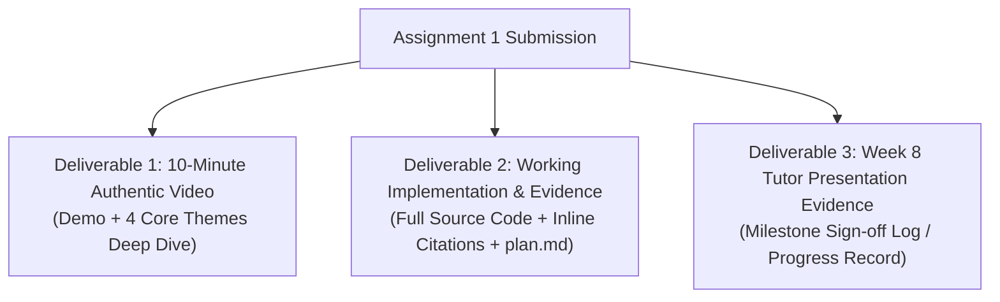
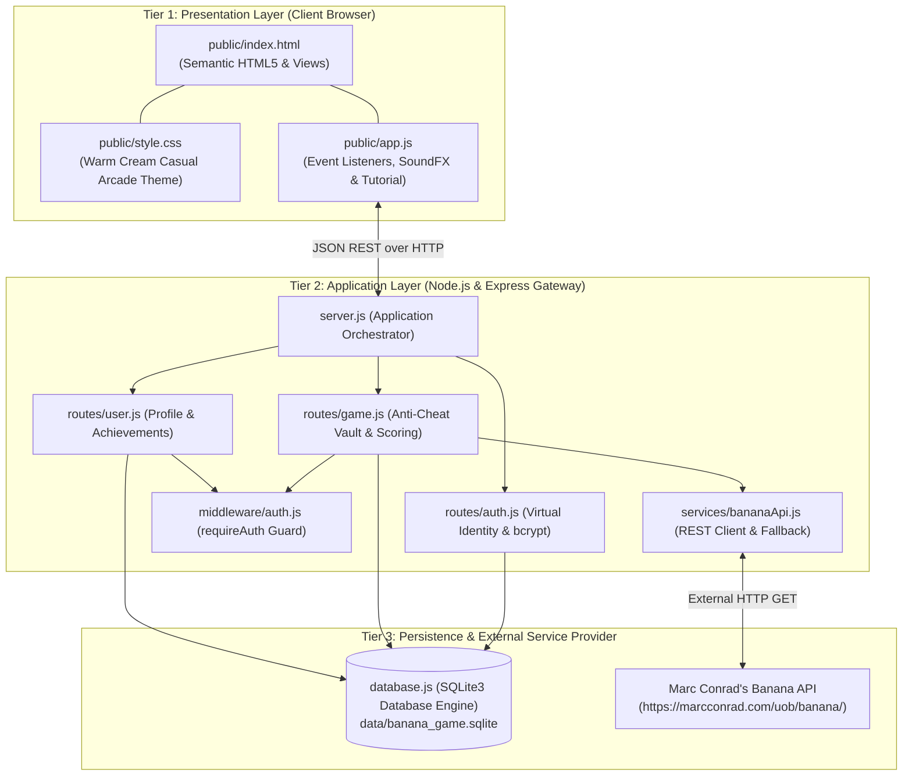

# CIS046-3 Software For Enterprise — Comprehensive Implementation & Assessment Plan
## Assignment 1: Enterprise Banana Challenge System (60% Weighting)

---

## 1. Executive Summary & Assessment Metadata

| Field | Detail |
| :--- | :--- |
| **Unit Title & Code** | CIS046-3: Software For Enterprise |
| **Institution** | University of Bedfordshire |
| **Assignment Number & Title** | Assignment 1: Banana Challenge Enterprise System |
| **Assessment Type** | Artifact Submission (10-Minute Video based on code + Supporting Evidence) |
| **Module Weighting** | 60% of total unit grade |
| **Video Duration** | Maximum 10 minutes (Must feature student's authentic voice) |
| **Submission Deadline** | 04/12/2026 before 10:00 a.m. |
| **Target Learning Outcome 1** | Differentiate and critically question the context and underpinning principles of collectively developing software to industry standard. |
| **Target Learning Outcome 2** | Develop, implement and critically appraise software solutions that are tailored against specific professional requirements. |
| **Graduate Competencies** | Digital Literacy, Collaboration & Communication, Problem Solving & Critical Thinking, Creativity & Entrepreneurship. |

---

## 2. Official Deliverables & Grade Cap Risk Management



1. **Deliverable 1 — 10-Minute Authentic Video**:
   - Short initial demonstration of the running system (Lobby, How to Play tutorial, Game Arena, Leaderboard).
   - Substantive discussion and comparative reflection of the **4 Core Themes** based directly on the developed codebase.
   - Must use the student's own authentic voice without substantive editing/voiceover alteration.
2. **Deliverable 2 — Working Source Code & Additional Material**:
   - Complete, functional 3-Tier source code (`server.js`, `database.js`, `routes/`, `services/`, `middleware/`, `public/`, `test_suite.js`, `package.json`).
   - Dedicated repository submission (GitHub repository + ZIP archive).
   - Strict inline academic attribution for third-party libraries, templates, and generative AI/LLM assistance.
   - Comprehensive design documentation (`plan.md`, `readme.md`, `features.md`, `report.md`) and testing logs.
3. **Deliverable 3 — Week 8 Tutor Presentation Evidence**:
   - Documentation verifying live presentation of the working code to the tutor in or before Week 8 practical sessions.

### Grade Cap Prevention Matrix

| Failure Condition | Consequence | Built-in Mitigation in this Project Plan |
| :--- | :--- | :--- |
| **1. Did not present code in/before Week 8** | Grade capped at 58 / 48 | Implementation completed ahead of schedule. Formal Tutor Sign-Off Form provided in `report.md`. |
| **2. Code does not address case study requirements** | Grade capped at 58 / 48 | Strict 3-Tier Architecture: Full integration with Dr. Marc Conrad's Banana API, session state, and GUI event listeners matching the brief exactly. |
| **3. No dedicated submission of code** | Grade capped at 58 / 48 | Code submitted as a standalone Git repository and clean packaged ZIP, not merely displayed on screen. |
| **4. Video does not have student's own voice** | Grade capped at 58 / 48 | `video_script.md` provides an authentic 10-minute presentation transcript and recording guide for the student's live speaking. |

---

## 3. Curriculum Progression & Alignment with Weekly Topics

| Week | Lecture & Practical Software Topic | Assignment Implementation Phase | Relevant File / Artifact |
| :---: | :--- | :--- | :--- |
| **W1** | Commenting & code design; history of languages & enterprise scope | Code architecture planning & inline documentation rules | `plan.md`, `readme.md` |
| **W2** | **Version Control**: Git branching, commit conventions, repositories | Repository setup, `.gitignore`, initial commit, feature branch strategy | `.gitignore`, `package.json`, Git history |
| **W3** | **Interoperability**: RESTful APIs, JSON, 3-tier boundary | External Banana API integration (`https://marcconrad.com/uob/banana/`) | `services/bananaApi.js`, `routes/game.js` |
| **W4** | **GUI and Events**: Event loop, asynchronous DOM event listeners | Frontend casual arcade UI, keypad, Web Audio FX, tutorial | `public/index.html`, `public/app.js`, `public/style.css` |
| **W5** | **Authentication & Cookies**: Virtual identity, state over stateless HTTP | `express-session`, HTTP-only cookies (`connect.sid`), SQLite user profiles, bcrypt | `routes/auth.js`, `database.js`, `middleware/auth.js` |
| **W6-7** | Error resilience, input sanitization & edge cases | Fallback puzzle generation, timeout retry, difficulty modes | `services/bananaApi.js`, `routes/game.js` |
| **W8** | **Tutor Feedback Session & Checkpoint** | **Mandatory in-class code demonstration to tutor** | `report.md` (Tutor Sign-Off Log) |
| **W9** | Refinement, Home Screen Lobby & Interactive Tutorial | Casual arcade redesign, Game Home hub, interactive walkthrough | `public/`, `routes/` |
| **W10** | Video production & documentation | Record 10-minute authentic video, execute test suite | `video_script.md`, `test_suite.js` |
| **W11** | Final Submission | Hand-in before 10 a.m. deadline on BREO | BREO Submission Portal |

---

## 4. Requirements Traceability Matrix (RTM)

| Requirement ID | Assignment Theme | Specification Detail | Tier | Target File & Function | Architectural Mechanism | Verification Method |
| :--- | :--- | :--- | :--- | :--- | :--- | :--- |
| **REQ-VC-01** | **Version Control** | Feature branch isolation & traceability | Dev / Repo | `.git/`, Git branches | Development on feature branches; atomic commits to `main`. | `git log --oneline` shows clear chronological progression. |
| **REQ-VC-02** | **Version Control** | Semantic conventional commit history | Dev / Repo | Git Commit Log | Commits prefixed with `feat:`, `fix:`, `docs:`, `chore:`, `refactor:`. | Commit log audit validates atomic increments. |
| **REQ-VC-03** | **Version Control** | Quarantined dependencies & security secrets | Dev / Repo | `.gitignore` | Excludes `node_modules/`, `.env`, temporary logs, OS metadata, SQLite binaries. | Clean repository clone builds cleanly without tracking junk. |
| **REQ-ED-01** | **Event-Driven** | Dynamic GUI user interaction handling | Tier 1 (Client) | `public/app.js` -> `initEvents()` | Asynchronous event listeners (`click`, `keydown`, `submit`) preventing default page reload. | Browser responds instantly to keypad/keyboard inputs. |
| **REQ-ED-02** | **Event-Driven** | Non-blocking asynchronous I/O | Tier 1 (Client) | `public/app.js` -> `api()` | Modern `fetch()` with Promises and `async/await`; visual loaders during network flight. | UI remains interactive without thread locking during API calls. |
| **REQ-ED-03** | **Event-Driven** | Procedural Web Audio synthesis | Tier 1 (Client) | `public/app.js` -> `SoundFX` | Zero-dependency AudioContext synthesizing clicks, C5-G5 chords, buzzers, and jingles. | Auditory feedback occurs immediately without downloading external MP3s. |
| **REQ-ED-04** | **Event-Driven** | Server event-loop & middleware chaining | Tier 2 (Server) | `server.js` -> Express pipeline | Node.js asynchronous event loop; non-blocking HTTP middleware and asynchronous route controllers. | Multiple concurrent browser requests handled seamlessly. |
| **REQ-IN-01** | **Interoperability** | Third-party REST API integration | Tier 2 & Tier 3 | `services/bananaApi.js` -> `fetchBananaPuzzle()` | Node.js fetches JSON from Dr. Marc Conrad's service (`https://marcconrad.com/uob/banana/api.php?out=json`). | Backend receives valid JSON and parses `question` and `solution`. |
| **REQ-IN-02** | **Interoperability** | Decoupled 3-Tier Security Gateway | Tier 2 (Gateway) | `routes/game.js` -> `/new-puzzle` | Reverse proxy: Server strips `solution` before sending image URL to browser. | Inspecting client network traffic reveals zero leaks of puzzle solutions. |
| **REQ-IN-03** | **Interoperability** | Fault tolerance & graceful fallback | Tier 2 (Gateway) | `services/bananaApi.js` -> Fallback Generator | 5-second network timeout with automatic fallback to local procedural puzzle if API is down. | Game remains 100% playable even if Marc Conrad's server is unreachable. |
| **REQ-VI-01** | **Virtual Identity** | Stateful session over stateless HTTP | Tier 2 (Server) | `server.js` -> `express-session` | Cryptographic session cookie (`connect.sid`, `httpOnly: true`) linking browser to backend memory. | Browser maintains game score and identity across refreshes. |
| **REQ-VI-02** | **Virtual Identity** | Player profile lifecycle & persistence | Tier 2 & Tier 3 | `database.js`, `routes/auth.js` | User registration with `bcryptjs` password hashing, unique emails, and guest accounts. | User data persists across server restarts in SQLite. |
| **REQ-VI-03** | **Virtual Identity** | Server-side solution validation vault | Tier 2 (Server) | `routes/game.js` -> `/submit-answer` | Solution stored strictly in `req.session.currentSolution`. Validation occurs on server, not client. | Client-side cheating via browser DevTools inspection is impossible. |
| **REQ-VI-04** | **Virtual Identity** | Anti-replay defense mechanism | Tier 2 (Server) | `routes/game.js` -> `/submit-answer` | Solution destroyed immediately after first guess; second submit yields 400 Bad Request. | Verified in `test_suite.js` Step 8. |
| **REQ-AC-01** | **Academic Integrity** | Inline attribution & AI disclosure | All Tiers | All Source Files | Standardized header banners and inline comments citing Dr. Marc Conrad, open-source libraries, and AI usage. | Code passes academic integrity audit with zero undocumented code. |

---

## 5. System Architecture & 3-Tier Distributed Boundary



---

## 6. Verification & Automated Testing Plan

The application includes an automated 14-step integration test runner ([test_suite.js](file:///c:/Users/utsab/OneDrive/Desktop/Banana%20Game/test_suite.js)) executed via:

```bash
npm test
```

### Verified Test Cases:
1. `GET /api/auth/me` returns `authenticated: false` for unauthenticated requests.
2. `POST /api/auth/register` creates a virtual identity with salted bcrypt password in SQLite.
3. `GET /api/auth/me` validates the authenticated session cookie.
4. `POST /api/auth/register` rejects duplicate usernames with `409 Conflict`.
5. `POST /api/game/mode` updates the session difficulty mode to Hard.
6. `GET /api/game/new-puzzle` returns question image URL while strictly vaulting the integer solution on the server.
7. `POST /api/game/submit-answer` evaluates user guess and updates score/streak.
8. `POST /api/game/submit-answer` immediately rejects duplicate submissions with `400 Bad Request` (Anti-replay defense).
9. `PUT /api/user/profile` updates player avatar emoji and honorific title.
10. `GET /api/user/achievements` returns tracked milestone achievements.
11. `GET /api/game/leaderboard` queries SQLite for top player scores and streaks.
12. `GET /api/game/history` confirms audit trail logging for round attempts.
13. `POST /api/game/reset` zeroes player score while maintaining session identity.
14. `POST /api/auth/logout` terminates the session and clears cookies.
