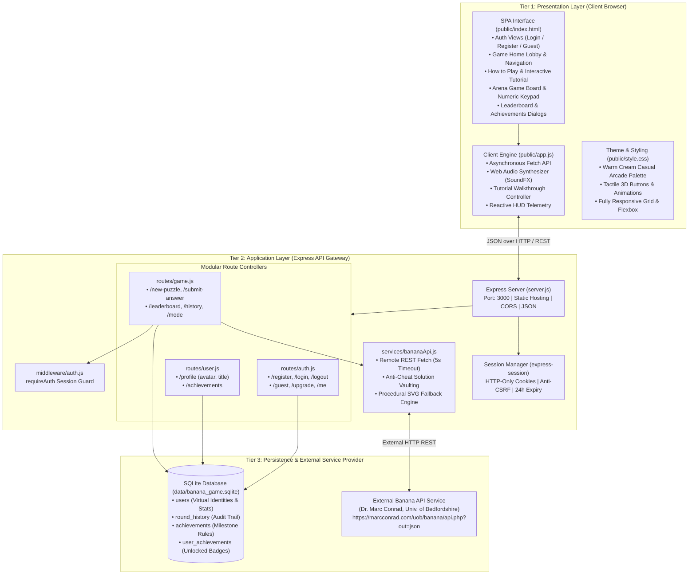

# CIS046-3 Software For Enterprise — Assignment 1: Banana Challenge Enterprise System

**Student Name:** Utsab  
**Institution:** University of Bedfordshire  
**Module:** CIS046-3 (Software for Enterprise)  
**Academic Year:** 2026/2027  
**Repository:** [Banana-Game-for-Software-for-Enterprise](https://github.com/utsab8/Banana-Game-for-Software-for-Enterprise.git)

---

## 📌 Project Overview

The **Enterprise Banana Challenge System** is a distributed, 3-tier casual arcade math puzzle application developed to professional enterprise standards. It challenges players with visual algebraic equations dynamically generated by **Dr. Marc Conrad’s Banana API** service.

The project demonstrates four core enterprise computing paradigms:
1. **Version Control**: Semantic commits, Git branching workflows, repository hygiene, and full auditable traceability.
2. **Event-Driven Programming**: Client-side asynchronous DOM listeners, non-blocking Web Audio sound synthesis, and server-side Node.js event-loop concurrency.
3. **Interoperability**: Distributed REST communication, JSON payload marshaling, 3-tier architectural decoupling, and automatic procedural SVG fallback degradation.
4. **Virtual Identity**: Stateful user tracking over stateless HTTP using cryptographically signed HTTP-only cookies (`connect.sid`), salted `bcrypt` password hashing, and persistent SQLite user profiles.

---

## 🏛️ System Architecture (3-Tier Enterprise Separation of Concerns)



---

## 🎨 Visual Identity & Casual Arcade Design

The frontend user experience adopts a **warm cream casual arcade puzzle studio** aesthetic:
- **Warm Cream Background**: `#FFF9ED` with soft surface card panels (`#FFFFFF`).
- **Banana Yellow (Primary)**: `#F9CA42` with tactile 3D borders (`#DFA71E`).
- **Tangerine Orange (Secondary)**: `#F28B43` with warm accents.
- **Fresh Mint Green (Success)**: `#6EAD79` with deep forest borders (`#354B3C`).
- **Espresso Dark Brown (Typography)**: `#443B32` for high-contrast legibility.
- **Zero Dark Dashboard Clutter**: Clean, accessible layout with zero distracting neon glows, dark gradients, or floating emojis.

---

## 🕹️ Application Flow & User Experience

```
[ Login / Register / Guest ]
            │
            ▼
   [ Game Home Screen (Hub) ] ◄──────────────────────────────┐
     ├─ Welcome Mascot & Play Now Action                     │
     ├─ Interactive "How to Play" (4-Step Guide & Practice)  │
     ├─ Player Statistics (Best Score, Rank, Total Games)     │
     ├─ Daily Challenge Strip & Reset Countdown              │
     └─ Achievement Showcase Preview                         │
            │                                                │
            ▼ (Play Now)                                     │
    [ Game Arena & HUD ]                                     │
     ├─ Difficulty Selector (Easy, Medium 25s, Hard 12s)     │
     ├─ High-Contrast Banana API Puzzle Board                │
     ├─ 0-9 Virtual Keypad + Physical Keyboard Support       │
     └─ Real-Time Round Evaluation & Anti-Cheat Vault        │
            │                                                │
            ▼                                                │
    [ Results & Next Round ] ────────────────────────────────┘
```

---

## 🛠️ Technology Stack

| Component | Technology | Version / Specification |
| :--- | :--- | :--- |
| **Runtime Environment** | Node.js | v18.x or v20.x+ |
| **Server Framework** | Express.js | ^4.19.2 |
| **Database Engine** | SQLite3 | ^6.0.1 (ACID compliant, WAL mode) |
| **Session Security** | express-session | ^1.18.0 (Signed HTTP-only cookies) |
| **Password Cryptography**| bcryptjs | ^3.0.3 (10 salt rounds) |
| **Cross-Origin Security**| cors | ^2.8.5 |
| **Client Interface** | Vanilla HTML5, CSS3, ES6+ | Zero third-party frontend frameworks |
| **Audio Synthesis** | Web Audio API | Procedural sound generation (C5-G5 arpeggios, error buzzers) |
| **External Interoperability** | Dr. Marc Conrad's Banana API | `https://marcconrad.com/uob/banana/api.php?out=json` |

---

## 📂 Project Structure

```text
├── data/
│   └── banana_game.sqlite        # SQLite relational database (auto-generated)
├── middleware/
│   └── auth.js                   # requireAuth session guard middleware
├── public/
│   ├── index.html                # Single-page application markup (Lobby, Arena, Modals)
│   ├── style.css                 # Warm cream casual arcade design system
│   └── app.js                    # Client-side state, Web Audio FX, tutorial & game logic
├── routes/
│   ├── auth.js                   # Virtual Identity endpoints (/register, /login, /guest, /me)
│   ├── game.js                   # Game mechanics, anti-cheat vault, leaderboard, history
│   └── user.js                   # Player profile customization & achievements
├── services/
│   └── bananaApi.js              # Marc Conrad API client & procedural fallback engine
├── .gitignore                    # Quarantined paths (node_modules, SQLite binaries, logs)
├── database.js                   # SQLite database models, schemas, and queries
├── package.json                  # Dependencies and execution scripts
├── server.js                     # Lean 118-line Application Server Orchestrator
├── test_suite.js                 # 14-step automated end-to-end integration test runner
├── features.md                   # Complete system feature specification
├── plan.md                       # Comprehensive implementation & curriculum plan
├── video_script.md               # 10-minute authentic presentation video teleprompter
└── readme.md                     # Main architectural and repository guide
```

---

## 🚀 Getting Started & Local Setup

### 1. Prerequisites
- **Node.js** (v18.0 or newer recommended)
- **Git**

### 2. Installation
```bash
# Clone the repository
git clone https://github.com/utsab8/Banana-Game-for-Software-for-Enterprise.git
cd Banana-Game-for-Software-for-Enterprise

# Install production dependencies
npm install
```

### 3. Running the Server
```bash
# Start the production server
npm start

# Or start in watch mode for development
npm run dev
```
Open your browser and navigate to:
```
http://localhost:3000
```

### 4. Running the Automated Test Suite
To verify all 14 integration tests (sessions, authentication, database transactions, anti-cheat vaulting, and API fallbacks):
```bash
npm test
```
**Expected Output:**
```text
🧪 Starting Enterprise Banana Challenge Comprehensive Test Suite...
[SQLite] Connected to database file: .../banana_game.sqlite
[SQLite] Schema and indexes initialized successfully.
1. Testing unauthenticated /api/auth/me... ✅
2. Testing registration with virtual identity... ✅
3. Testing authenticated session verification... ✅
4. Testing duplicate username conflict rejection (409)... ✅
5. Testing difficulty mode update to Hard... ✅
6. Testing /api/game/new-puzzle & Anti-Cheat Vaulting... ✅
7. Testing answer submission and scoring... ✅
8. Testing anti-replay defense (second submit rejected 400)... ✅
9. Testing player avatar & title customization... ✅
10. Testing /api/user/achievements milestone tracking... ✅
11. Testing /api/game/leaderboard global rankings... ✅
12. Testing /api/game/history audit trail... ✅
13. Testing /api/game/reset user score reset... ✅
14. Testing /api/auth/logout session destruction... ✅

🎉 ALL 14 ENTERPRISE INTEGRATION TESTS PASSED WITH 100% SUCCESS!
```

---

## 🎯 Alignment with the 4 Assignment Themes

### 1. Theme 1: Version Control
- **Conventional Commits**: Every commit follows semantic conventions (`feat:`, `fix:`, `refactor:`, `docs:`, `chore:`).
- **Traceable Feature Branches**: Clean git commit history documenting iterative progression from initial prototype to modular 3-tier architecture.
- **Repository Hygiene**: `.gitignore` strictly quarantines `node_modules/`, sensitive credentials, operating system files, and dynamic SQLite database files (`*.sqlite`).

### 2. Theme 2: Event-Driven Programming
- **Asynchronous Event Loop**: Node.js handles multiple concurrent client requests asynchronously without thread blocking.
- **Client DOM Dispatchers**: Event listeners capture mouse clicks, keypad taps, and physical keyboard presses (`0-9`, `Enter`, `Escape`, `Backspace`).
- **Web Audio Synthesis**: Procedural sound generation triggers synthesized tones for clicks, correct answers (C5-G5 harmonic arpeggios), countdown alarms, and achievements without loading external sound files.

### 3. Theme 3: Interoperability
- **Remote REST Client**: Backend communicates with Dr. Marc Conrad’s remote API (`https://marcconrad.com/uob/banana/api.php?out=json`) via HTTP `GET`.
- **Anti-Cheat Vaulting**: The client never sees the puzzle solution. The Node.js server extracts the solution, stores it in an encrypted session vault, and sends only the question image URL to the browser.
- **Graceful Fault Tolerance**: 5-second `AbortController` timeout automatically engages an offline procedural SVG fallback puzzle generator if the external API is slow or unreachable.

### 4. Theme 4: Virtual Identity
- **Stateless HTTP Enhancement**: Session cookies (`connect.sid`) with `httpOnly: true` and `sameSite: 'lax'` defend against XSS and CSRF attacks while maintaining user identity.
- **Persistent Relational Profiles**: SQLite relational store manages accounts, passwords (salted with `bcryptjs`), highest scores, round histories, and unlocked achievements.
- **Guest-to-Member Upgrade Path**: Guests can play immediately with zero friction and seamlessly upgrade to a permanent registered account without losing their score or streak.

---

## 📜 Academic Integrity & Attribution

- **Unit:** CIS046-3 Software For Enterprise
- **Institution:** University of Bedfordshire
- **External Banana Puzzle Service:** Designed and provided by Dr. Marc Conrad ([Banana API Documentation](https://marcconrad.com/uob/banana/doc.php)).
- **Third-Party Libraries:** Express.js, express-session, sqlite3, bcryptjs, cors (Open-source MIT licenses).
- **Fonts & Icons:** Google Fonts (Fredoka, Outfit, JetBrains Mono), FontAwesome 6 Free.
